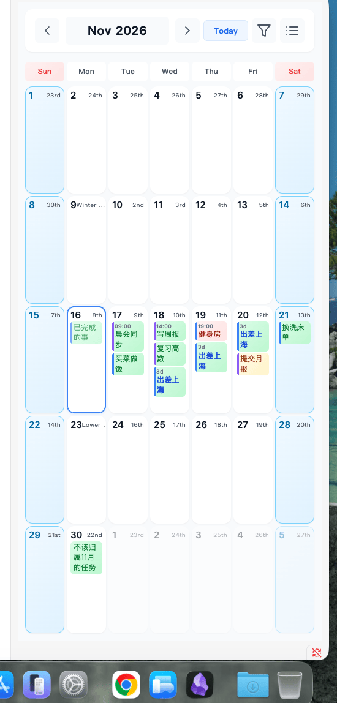
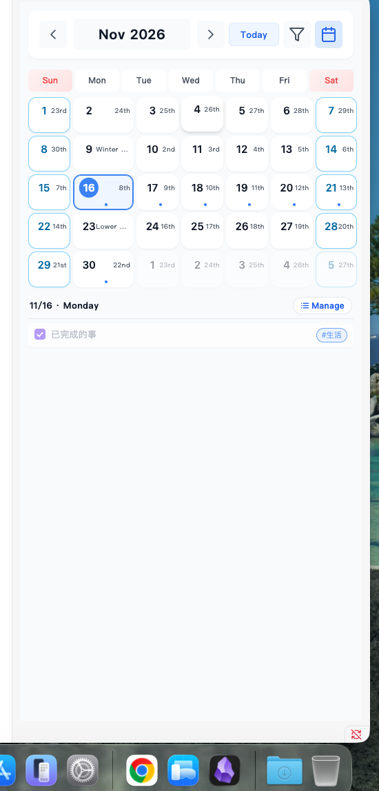
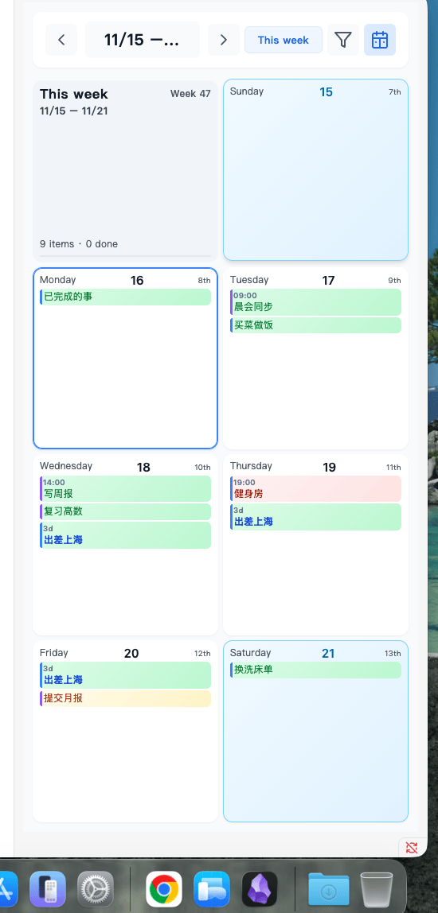
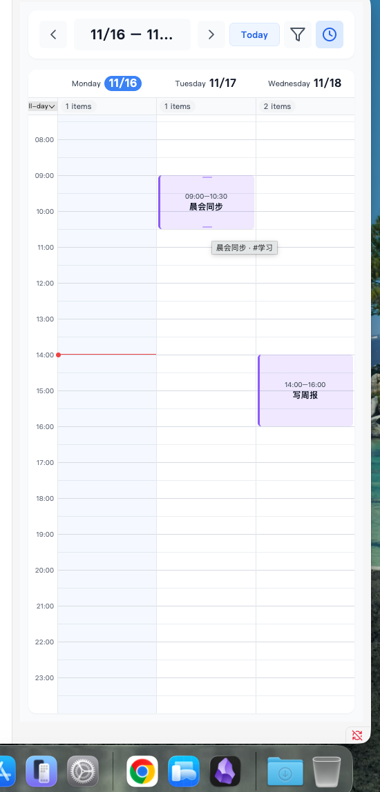
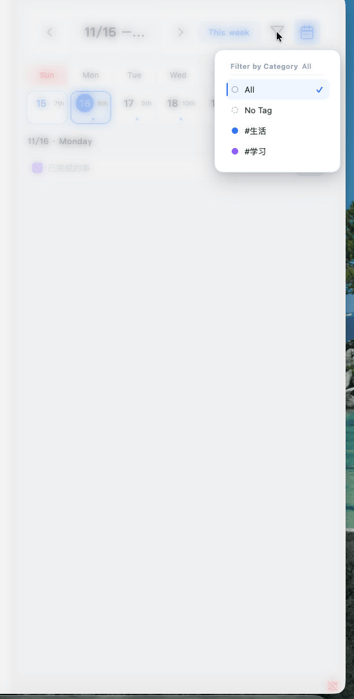
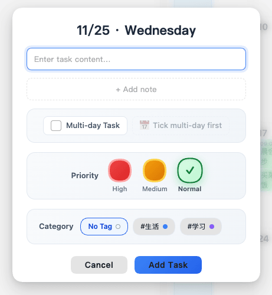
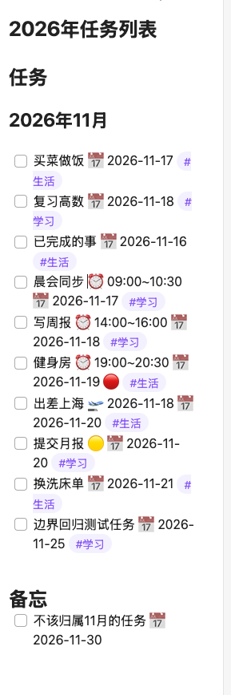
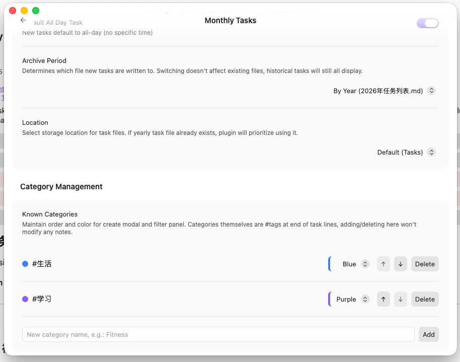

# 月历任务插件 (Monthly Tasks)

一款为 Obsidian 打造的滴答清单风格月视图任务管理插件，支持农历显示、节假日标注和调休信息展示。

> **English speakers:** see the [English section](#english) below for installation, usage, the task file format, and privacy details.

---

## 安装

### 方式一：社区插件市场（推荐）

Obsidian 设置 → 第三方插件 → 浏览，搜索「Monthly Tasks」→ 安装 → 启用。插件已在官方社区目录里，之后的更新也在这个页面点一下就能拿到。

> 社区目录安装时，客户端只逐个下载 Release 里的 `main.js`、`manifest.json`、`styles.css` 三份文件——节假日兜底数据就打包在 `main.js` 里，所以离线也能显示已内置年份。

### 方式二：手动安装

1. 打开本仓库 [Releases 页面](https://github.com/duany2026/obsidian-monthly-tasks/releases/latest)，下载最新的 `monthly-tasks-*.zip`
2. 解压，得到文件夹 `monthly-tasks`
3. 打开你的 Obsidian 笔记库文件夹，进入隐藏目录 `.obsidian/plugins/`（如果没见过这个目录：在 Obsidian 里点左下角仓库图标 →「在系统资源管理器中显示仓库」，进去就能看到 `.obsidian`）
4. 把解压出的 `monthly-tasks` 文件夹整个放进去，变成 `.obsidian/plugins/monthly-tasks/`（里面应有 `main.js`、`manifest.json`、`styles.css`）
5. 重启 Obsidian → 设置 → 第三方插件 → 关闭「安全模式」→ 在已安装插件列表中启用「Monthly Tasks」（列表显示 manifest 里的英文名；应用内视图与命令仍是中文「月历任务」）

### 方式三：BRAT（可自动更新）

1. 安装 [BRAT](https://github.com/TfTHacker/obsidian42-brat) 插件
2. 在 BRAT 设置中添加本仓库地址：`duany2026/obsidian-monthly-tasks`
3. 启用插件即可，之后可跟随仓库更新

---

## 功能特性

### 核心功能
- **月视图日历** - 清晰的 5-6 周动态网格布局，查看每月任务一目了然
- **五档视图** - 大月 / 小月 / 大周 / 小周 / 三天视图，顶栏一键切换（见「使用方法」的对照表）
- **类别筛选** - 任务行尾 `#标签` 即类别，顶栏漏斗按类别筛、配色可在设置里调
- **三天视图** - 三天 3 列 × 24 小时，带时间的任务画成按类别着色的时间块（未分类为中性灰），没有时间的任务收在列头下方的吸顶全天条里，默认收起成一行「全天」＋每日条数，点条带或「全天」展开后按日逐条列出（有几条列几条）；点空白先拉出草稿条（上下边都能拖，也能横向拖到别的日期），点条内 ＋ 才按该时段新建；已保存的块按住可上下拖改时间、横向拖换日期，拖上/下边改起止
- **任务管理** - 快速创建、完成、删除任务
- **优先级标记** - 🔴 高优先级 / 🟡 中优先级 / 普通
- **跨天任务** - 多日任务在起止日期内的每一天自动显示
- **农历显示** - 自动显示中国传统农历日期

### 节假日
- **法定节假日标注** - 春节、国庆、五一劳动节等用红色背景高亮
- **调休日标注** - 周末上班日用蓝色背景标注
- **按需数据更新** - 浏览到未缓存年份时自动按需获取在线数据；启动预取与手动刷新可选（源链与已知状况见「节假日数据」一节）

### 用户体验
- **深色模式** - 自动适配 Obsidian 主题
- **移动端适配** - 响应式设计，手机平板都能用；格子内任务超出可视区时可直接上下滑动查看（不出现滚动条，底部渐隐提示「还能滑」）；新建任务里的时间框是一整颗「时间＋箭头」胶囊，点框内任意位置都会弹出系统时间选择器
- **操作简便** - 点击日期即可添加任务，支持命令面板操作
- **删除可撤销** - 删除任务后 6 秒内点浮层里的「撤销」即可原样写回（连备注和创建时间等标记一起还原）

---

## 使用方法

### 打开月历视图

1. 点击左侧边栏的日历图标
2. 或使用命令面板（`Ctrl/Cmd + P`）搜索「月历任务」
3. 选择「打开月历任务视图」

### 视图五档

顶栏右侧的切换按钮随时换视图；「默认视图」设置决定打开时先用哪一档，切换后自动记住：

| 视图 | 形态 |
|------|------|
| **大月** | 整月铺开，任务文字直接写在日期格子里 |
| **小月** | 整月铺开，格子只出圆点，任务列表在下方明细区 |
| **大周** | 只看这一周，任务文字写在格子里 |
| **小周** | 只看这一周，格子出圆点，任务列在下方 |
| **三天视图** | 三天 × 24 小时，带时间的任务画成可拖拽的时间块 |

顶栏漏斗图标按类别筛选：任务行尾的 `#标签` 就是类别，可多选，面板开着期间只显示选中类别。

### 添加任务

1. 点击任意日期格子
2. 在弹窗中输入任务内容
3. 可选择：
   - 📅 **截止日期** - 默认当天
   - ⏰ **时间范围** - 非全天任务可设置起止时间（需在设置中关闭「默认全天任务」才会显示时间输入）
   - 🎨 **优先级** - 高/中/普通
   - 🛫 **跨天任务** - 设置开始日期后，任务在起止日期内的每一天重复显示（格子内以蓝色渐变条标识，首日带续接箭头）
   - 🏷️ **类别** - 点任务行尾 `#标签` 选类别（生活/学习等，设置里可增删改色）
4. 按 **Enter** 键或点击确认按钮创建任务

### 三天视图与拖拽排程

顶栏视图菜单切到「三天视图」：三天 3 列 × 24 小时铺开，带时间的任务画成时间块。

- **先拉草稿再新建**：点空白时段出一根草稿条（不写文件），拖上下边选起止、拖条体换位置（可横向拖到别的日期列），点条内 ＋ 才打开新建窗，日期时间已按草稿预填
- **拖动改日程**：已保存的时间块按住正文可整块挪（横移换日期、竖移改时间），拖上/下边改起止，15 分钟吸附；只改任务行里的 `⏰` 段，不动备注、不重排文件
- **全天任务条**：列头下方的全天条默认收成一行「全天＋每日条数」，点条带展开逐条查看；时间写坏（如 `22:00~02:00`）的任务也会归到这里，时间块则以红色虚线描边提示
- 打开时自动停在「现在」附近；翻走后用顶栏「回到今天」一步回来
### 任务格式

任务以标准 Obsidian checklist 格式存储：

```markdown
- [ ] 完成任务 📅 2026-04-22
- [x] 已完成任务 📅 2026-04-21
- [ ] 跨天任务 🛫 2026-04-22 📅 2026-04-25
- [ ] 带时间的任务 ⏰ 09:00~12:00 📅 2026-04-22
- [ ] 高优先级任务 🔴 📅 2026-04-22
- [ ] 中优先级任务 🟡 📅 2026-04-22
- [ ] 带类别的任务 📅 2026-04-22 #生活
```

因为就是普通 checklist 行，手写或别的插件生成的任务行也会被读取显示；笔记里你自己写的标题和其它内容都不会被改动。

任务自动保存到 `任务/YYYY年任务列表.md` 文件中（统一归集，不写入日记文件）。

**插件只认两种任务列表文件名**：`YYYY年任务列表.md`（按年）与 `YYYY年MM月任务列表.md`（按月），放在库里哪个文件夹都算数。默认「任务来源 = 只读任务列表文件」，只有这两类文件上月历；设置里可切到「读取全库」，此时所有笔记里带 📅/🛫 的清单行都会上月历——但注意，那一档下在月历里编辑、删除会直接改动原笔记。

---

## 设置选项

设置页分四档，行名与下表一致：

| 分区 | 设置项 | 说明 | 默认值 |
|------|--------|------|--------|
| 显示 | 默认视图 | 打开月历默认用哪一档：大月 / 小月 / 大周 / 小周 / 三天视图；顶栏切换后这里会跟着变成最后用的那一档 | 大月 |
| 显示 | 显示已完成任务 | 在月历中显示已完成的任务 | 开启 |
| 显示 | 已完成隐藏删除线 | 打开后已完成任务隐藏删除线（同时隐藏过期任务的红色竖线） | 开启 |
| 显示 | 显示农历 | 显示中国传统农历日期 | 开启 |
| 显示 | 显示节假日 | 显示法定节假日与调休上班 | 开启 |
| 显示 | 每周第一天 | 周日 / 周一 / 周六 | 周日 |
| 显示 | 每日任务显示数量 | 每个日期格子最多显示的任务数量；当天面板超过这个数默认收起，「查看全部」也按它出现 | 5（可选 3–10） |
| 任务 | 默认全天任务 | 新建任务时默认为全天任务（不带具体时间） | 开启 |
| 任务 | 任务来源 | 只读任务列表文件：只管 `YYYY年任务列表.md` / `YYYY年MM月任务列表.md`；读取全库：所有笔记里带 📅/🛫 的清单行都上月历（此时月历里的编辑、删除会直接改动原笔记） | 只读任务列表文件（老用户升级后保持「读取全库」） |
| 任务 | 归档周期 | 决定新任务写入哪个文件（按年 `YYYY年任务列表.md` 或按月 `YYYY年MM月任务列表.md`）；切换不影响已有文件，历史任务仍全部显示。下拉里的示例文件名跟着当天走 | 按年 |
| 任务 | 记录位置 | 任务文件的存放位置；若已有同名任务文件，插件优先使用它。已保存的文件夹被删掉时，下拉里会补一项「（已失效）」回显原路径 | 默认（`任务/`） |
| 类别管理 | 已知类别 | 维护创建弹窗与漏斗面板里的顺序和颜色。类别本身是任务行尾的 `#标签`，在这里增删不会改动任何笔记 | 生活、学习 |
| 节假日数据 | 启动时自动刷新节假日 | 启动时预取今年及前后各一年（共三年）的节假日数据 | 关闭 |
| 节假日数据 | 刷新节假日数据 | 手动强制刷新上述三年 | 按钮 |

> 界面语言不提供单独选项：始终跟随 Obsidian 的界面语言（简体中文 / 繁体中文 / English）。
>
> 归档文件名始终是简体中文（`YYYY年任务列表.md` / `YYYY年MM月任务列表.md`），不随界面语言变——繁体和英文界面上看到的示例也是这个写法，因为插件真正写盘用的就是它。

---

## 数据存储

插件数据存储在插件设置中：
- `data.json` - 用户设置和节假日缓存
- `任务/YYYY年任务列表.md`（按年归档，默认）或 `任务/YYYY年MM月任务列表.md`（按月归档） - 任务内容文件

---

## 节假日数据

### 数据获取链
按顺序尝试，任一源成功即采用：

1. **[holiday-cn](https://github.com/NateScarlet/holiday-cn)** — 社区维护，跟随国务院公告及时更新，覆盖 **2007 年至今**。经多个 CDN 镜像按顺序访问（`cdn.jsdelivr.net` → `fastly.jsdelivr.net` → `gcore.jsdelivr.net` → `raw.githubusercontent.com`），任一可达即采用——主域名在部分网络下不可达，只试一个会表现为「刷新失败且时好时坏」
2. **[timor.tech](https://timor.tech)** — 备份数据源。**已知状况（2026-10-12 实测）**：该站对本插件的请求返回 `403` 与 Cloudflare 人机验证页（HTML 而非 JSON），因此这一级**实际不起作用**——主源抖动时就是失败，而不是"切到备份源"。插件仍会尝试它，因为该状况可能随对方策略变化而恢复
3. **内置兜底** — 随 `main.js` 一起分发的 `BUILTIN_HOLIDAYS` 数据块（2022–2026 官方数据，离线可用）

### 网络使用与隐私

插件**只在获取节假日数据时联网**，访问的就是上面列出的那几个地址（`holiday-cn` 的 CDN 镜像与 `timor.tech`），请求内容只有年份，不携带任何笔记内容、路径、设置或身份信息。

- 无账号要求，无付费功能，无遥测/统计，不上传任何用户数据
- 不访问仓库以外的文件；读写只发生在你的库内（任务文件）与插件自己的目录（`data.json` 设置、可选的 `holidays.json` 覆盖文件）
- 断网时插件照常工作：已缓存年份与内置年份都能显示，只是取不到新年份

### 内置兜底数据

- 随插件分发，无网络时仍可显示已内置年份；官方未发布的年份不写预测数据
- 数据本体在 `main.js` 的 `BUILTIN_HOLIDAYS` 标记块里。**为什么不只放一个 JSON 文件**：从插件市场安装时 Obsidian 只下载 `main.js`、`manifest.json`、`styles.css` 三份，仓库里的 `holidays.json` 不会进你的插件目录——只依赖外部文件的话，市场安装的用户就完全没有离线兜底
- 仓库里的 `holidays.json` 仍是可编辑的数据源，改完跑 `node scripts/sync-holidays.mjs` 同步进 `main.js`（CI 会拦住两者漂移）
- 你也可以往插件目录另放一份 `holidays.json`，它**按年覆盖**内置副本，没写进去的年份仍由内置数据兜着。格式：

```json
{
  "2026": [
    { "date": "2026-01-01", "name": "元旦", "type": "legal", "isOff": true },
    { "date": "2026-05-09", "name": "班", "type": "workday", "isOff": false }
  ]
}
```

- 内置数据不再逐年维护：新年份由上面的数据源自动覆盖

### 使用方式
- 浏览到未缓存年份（如 2007 年起的历史年份、未来新年份）时会自动按需获取该年数据
- 「启动时自动刷新节假日」默认关闭；开启后启动时预取**今年及前后各一年（共三年）**，**全程静默**——成功、失败都不弹任何通知（失败只留控制台日志）。需要可见反馈时点「刷新节假日数据」按钮强制刷新这三年：它一次请求三个年份，任一年失败会提示「部分成功」，三年全失败才提示刷新失败
- 数据获取失败按 5 分钟退避，期间浏览不重复请求

---

## 界面预览

### 五档视图

| 大月（任务写在格子里） | 小月（圆点 + 下方明细） |
|---|---|
|  |  |
| **大周（一周 × 任务在格子里）** | **小周（一周 × 圆点 + 列表）** |
|  |  |
| **三天视图（24 小时时间轴）** | |
|  | |

### 顶栏菜单与弹窗

| 类别筛选（漏斗，多选） | 视图切换 | 新建任务 |
|---|---|---|
|  |  |  |

### 细节

| 删除后 6 秒内可撤销 | 任务文件原文（普通 checklist） | 设置页四档分区 |
|---|---|---|
|  |  |  |

---

## 技术架构

### 模块结构

| 模块 | 说明 |
|------|------|
| TaskModel | 任务数据模型，包含任务解析、优先级提取等工具函数 |
| TaskParser | 任务解析器，负责解析 Obsidian 库中的任务，管理缓存 |
| Calendar | 日历工具，生成月历网格数据 |
| LunarCalendar | 农历转换，支持 1900-2100 年的农历日期转换 |
| HolidayManager | 节假日管理器，管理法定节假日和调休信息 |
| MonthlyView | 月历视图，渲染日历网格和任务列表 |
| CreateTaskModal | 创建任务弹窗，处理任务创建表单 |
| DatePickerModal | 日期选择器弹窗，支持快速切换年月 |
| MonthlyTasksPlugin | 插件主类，管理插件生命周期 |
| MonthlyTasksSettingTab | 设置界面，提供用户配置选项 |

### 技术栈

- **语言**: JavaScript（`main.js` 为唯一源码，直接手工维护，无构建步骤）
- **框架**: Obsidian API
- **样式**: CSS（移动端优先设计）
- **数据**: 在线数据源链 + `holidays.json` 内置兜底（详见「节假日数据」一节）

---

## English

### Overview

Monthly Tasks is a TickTick-style task view for Obsidian. It lays your tasks out on a month grid, a single week, or a three-day hour-by-hour timeline, and marks Chinese lunar dates, statutory holidays, and make-up workdays on the calendar. Tasks are stored as ordinary Obsidian checklist lines in a Markdown note inside your vault — there is no database and no account. The interface follows Obsidian's own language (Simplified Chinese, Traditional Chinese, or English); the view title and the command palette entries stay in Chinese.

### Installation

**From the community directory:** Settings → Community plugins → Browse, search for "Monthly Tasks", install, then enable. Updates are one click on the same page.

**Manual installation:**

1. Download `monthly-tasks-<version>.zip` from the [Releases page](https://github.com/duany2026/obsidian-monthly-tasks/releases/latest).
2. Unzip it. You get a folder named `monthly-tasks` containing `main.js`, `manifest.json`, `styles.css`, `holidays.json`, `versions.json`, `README.md`, and `LICENSE`.
3. Copy that folder into your vault's `.obsidian/plugins/` directory, so you end up with `.obsidian/plugins/monthly-tasks/`.
4. Restart Obsidian, go to Settings → Community plugins, turn off Restricted mode, and enable **Monthly Tasks**.

Installing from the directory downloads only `main.js`, `manifest.json`, and `styles.css`. The offline holiday fallback (2022–2026) is embedded in `main.js` for exactly that reason, so a directory install still shows built-in years with no network. You can also install [BRAT](https://github.com/TfTHacker/obsidian42-brat) and add `duany2026/obsidian-monthly-tasks`.

### Views

Switch views from the menu in the view's top bar. The English labels are:

| Label | What you get |
|-------|--------------|
| **Month · Cells** | The whole month, tasks written inside each day cell |
| **Month · Agenda** | The whole month, cells show dots only, tasks listed below |
| **Week · Cells** | One week only, tasks written in the cells |
| **Week · Agenda** | One week only, tasks listed below |
| **3-Day Timeline** | Three days × 24 hours, timed tasks drawn as draggable blocks |

Which one opens by default is the "Default View" setting; the menu writes your last choice back into it.

### Usage

1. Click the calendar icon in the left ribbon, or run the command "打开月历任务视图" (Open Monthly Tasks View). There are also "Refresh" and "Cycle view" commands.
2. Click any day cell to add a task. In the dialog you can set a due date, a time range (only shown when the "Default All Day Task" setting is off), a priority (high / medium / normal), a start date for multi-day tasks, and a category. Press Enter or confirm.
3. Mark done, edit, or delete from the task row. Deleting is undoable for 6 seconds via the "撤销" (undo) button in the popup, which writes the line back exactly as it was, notes and markers included.
4. In the 3-Day Timeline, click empty space to pull out a draft block, drag its top or bottom edge for the time range, drag the body to move it (including sideways into another day), then press the ＋ inside the block to open the create dialog pre-filled from the draft. Saved blocks can be dragged the same way; dragging only rewrites the `⏰` segment of that task line and never touches your notes or their order. Timed tasks snap to the nearest 15 minutes. Tasks without a time — or with a broken range such as `22:00~02:00` — collect in the sticky all-day strip under the column headers, collapsed to one line showing the per-day counts.

### Task file format

Tasks are standard Obsidian checklist lines with emoji markers:

```markdown
- [ ] Task 📅 2026-04-22
- [x] Done task 📅 2026-04-21
- [ ] Multi-day task 🛫 2026-04-22 📅 2026-04-25
- [ ] Timed task ⏰ 09:00~12:00 📅 2026-04-22
- [ ] High priority task 🔴 📅 2026-04-22
- [ ] Medium priority task 🟡 📅 2026-04-22
- [ ] Task with a category 📅 2026-04-22 #生活
```

`📅` is the due date, `🛫` the start date of a multi-day task (it then shows on every day in between), `⏰` the time range, `🔴` / `🟡` the priority, and a trailing `#tag` the category. Because these are plain checklist lines, tasks written by other plugins and by hand are read and displayed too.

Everything goes into one archive note rather than into your daily notes: `任务/YYYY年任务列表.md` by year, or `任务/YYYY年MM月任务列表.md` by month ("Archive Period" setting). The folder is the "Location" setting. **Those file names are always Simplified Chinese**, whatever your interface language is, because that is literally what gets written to disk. Your own headings and unrelated content in the note are left alone.

Only these two task-list file names count: `YYYY年任务列表.md` (yearly) and `YYYY年MM月任务列表.md` (monthly), in any folder. The default "Task source" setting reads **task list files only**; switch it to "Entire vault" and every dated `📅`/`🛫` checklist line in any note joins the calendar — in that mode, editing or deleting a task from the calendar modifies the original note directly. New tasks you create from the calendar are always written into a task-list file.

### Settings

Four groups: **Display** (default view, show completed tasks, hide strikethrough for completed, show lunar dates, show holidays, first day of week, how many tasks each day cell shows before collapsing), **Tasks** (default all-day task, task source — task list files only vs. entire vault — archive period, location), **Category Management** (order and colour of the categories shown in the create dialog and the filter panel — a category is just a `#tag` on the task line, so adding or deleting one here never edits a note), and **Holiday Data** (auto-refresh on startup, manual refresh button).

### Holidays, network use, and privacy

The plugin only goes online to fetch holiday data, and only to the sources listed in the [节假日数据](#节假日数据) section: the `holiday-cn` CDN mirrors, then `timor.tech`, then the built-in fallback. A request carries nothing but a year — no note content, no paths, no settings, no identity. There is no account, no paid feature, no telemetry, and nothing is uploaded.

Prefetching on startup is **off by default**. Otherwise data is fetched on demand when you browse to a year that is neither cached nor built in (2022–2026 are built in; `holiday-cn` covers 2007 onward). Failures back off for 5 minutes. Offline, everything still works for cached and built-in years. Reads and writes stay inside your vault (the task notes) and the plugin's own folder (`data.json` for settings and the holiday cache, an optional `holidays.json` that overrides built-in data year by year).

### Compatibility and license

Obsidian 0.15.0 or newer, desktop and mobile (no `isDesktopOnly`). Mobile is a first-class layout, not a squeezed desktop view: cells scroll in place without a scrollbar and fade at the bottom to hint there is more, and the time input is a single pill that opens the system time picker wherever you tap it. Lunar conversion covers 1900–2100.

MIT License — see [LICENSE](./LICENSE).

---

## 更新日志

完整版本历史见 [CHANGELOG.md](./CHANGELOG.md)——GitHub Release 的说明也从同一处提取，本文不再重复维护一份。

> 这里刻意不写「当前版本 vX.Y.Z」：版本号已在 `manifest.json`、`versions.json`、CHANGELOG 与源码头注释四处维护，每加一处重复就多一处发版时漏改、进而与线上 Release 分叉的地方。

---

## 发布打包

仓库根目录即插件目录，`.github/workflows/release.yml` 在推送标签时自动打包，但先卡一道门禁：**标签必须与 `manifest.json` 的 `version` 逐字相同、不带 `v` 前缀**，且版本号是 `x.y.z` 三段式，`versions.json` 里必须登记了这一版——不满足就直接失败退出，而不是产出一个社区目录永远认不到的发行版（目录是按「tag == manifest.version」去找 Release 再下载资产的，`v1.8.4` 这种写法它匹配不上）。

Release 里挂四个资产：`main.js`、`manifest.json`、`styles.css` 三份独立文件（客户端安装时逐个下载的就是这三份），外加一个手动安装用的 zip。zip 内含 `main.js`、`manifest.json`、`styles.css`、`holidays.json`、`versions.json`、`README.md`、`LICENSE` 七个文件，**不含 `data.json`**（`.gitignore` 已排除）——其中存有作者本机的设置（如节假日自动刷新开关）与节假日缓存，会让新用户安装后即继承作者设置、启动就联网预取。插件的联网口径是：**默认不预取**（启动预取由「启动时自动刷新」控制，默认关）；浏览到未内置年份（2022-2026 以外）时会**按需**向在线数据源请求该年数据（源链与已知状况见「节假日数据」一节）。

---

## 作者

**duany** （[@duany2026](https://github.com/duany2026)）

- 仓库：<https://github.com/duany2026/obsidian-monthly-tasks>
- 反馈问题或建议：<https://github.com/duany2026/obsidian-monthly-tasks/issues>

---

## License

MIT License - 详见 [LICENSE](./LICENSE) 文件

---

## 贡献

欢迎提交 Issue 和 Pull Request！改代码前请先读 [CONTRIBUTING.md](./CONTRIBUTING.md)——里面记着换行符约定、版本号要对齐的四处、发版流程、手机端「不热更新所以改了没生效」的排查前提，以及任务文件写入的数据安全红线。
